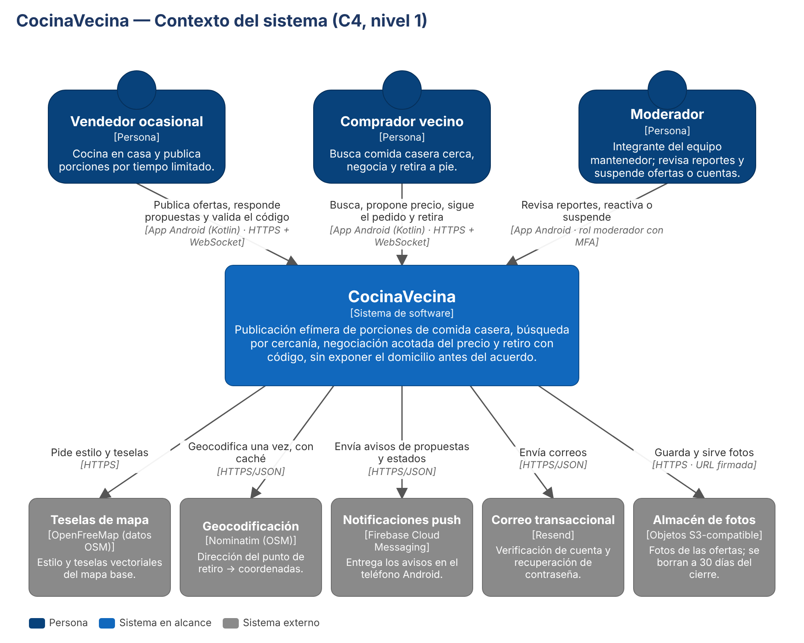

# CocinaVecina

Plataforma móvil para ofrecer y retirar porciones de comida casera entre vecinos del Gran Concepción:
publicación efímera, búsqueda por cercanía, negociación acotada del precio, privacidad progresiva del
domicilio y retiro con código. Proyecto Informático · Ingeniería Civil Informática · UdeC.

Este repositorio es la **base para seguir desarrollando** el modelo elegido (ALT-1, monolito modular):

| Carpeta | Qué contiene | Tecnología |
|---|---|---|
| `backend/` | API REST + WebSocket y worker de tareas | Java 21, Spring Boot 4.1, Gradle (Kotlin DSL) con catálogo `gradle/libs.versions.toml` |
| `android/` | App nativa | Kotlin, Jetpack Compose, MapLibre + OpenFreeMap, Retrofit, FCM; Gradle con catálogo `gradle/libs.versions.toml` |
| `infra/` | Despliegue en un servidor | Docker Compose: PostgreSQL + PostGIS, API (con TLS propio), worker y Nginx (fotos) |
| `docs/` | Arquitectura, decisiones y contrato | C4, ADR, OpenAPI 3.0 |
| `.github/workflows/` | Integración continua | compila y prueba backend y app; valida el contrato |



## Requisitos

- JDK 21 (Temurin recomendado) y Docker con Docker Compose.
- Android Studio reciente con Android SDK 35 (para la app).
- No se usan servicios de pago: OpenFreeMap, Nominatim, FCM, Resend (plan gratuito), Let's Encrypt y
  Cloudflare R2 (opcional, plan gratuito).

## Puesta en marcha local (≈ 5 min)

```bash
cd infra && docker compose up -d && cd ..
cd backend && ./gradlew bootRun
```

El primer comando levanta solo la base (PostGIS); el segundo deja la API en `http://localhost:8080`, con
las tareas programadas corriendo dentro de la misma API. Flyway crea el esquema al arrancar. Sin SMTP
configurado, el enlace de verificación del registro se escribe en el log de la API: ábrelo en el navegador
para activar la cuenta. En desarrollo la API también sirve las fotos en `/photos/**`.

App: abrir la carpeta `android/` en Android Studio y ejecutar en un emulador. El emulador llega a la API por
`http://10.0.2.2:8080` (`cocinavecina.apiUrl` en `android/gradle.properties`).

Prueba rápida de la API:

```bash
curl -X POST localhost:8080/v1/auth/register -H 'Content-Type: application/json' -d '{
  "email":"vendedora@example.com","displayName":"Ana","password":"una-clave-larga",
  "phone":"+56911112222","role":"SELLER","adult":true,"acceptsTerms":true}'
curl -X POST localhost:8080/v1/auth/login -H 'Content-Type: application/json' \
  -d '{"email":"vendedora@example.com","password":"una-clave-larga"}'
```

Entre ambos comandos hay que abrir el enlace de verificación que aparece en el log.

**Primer moderador.** El rol no se obtiene por registro (RNF-S-2): registrarse normalmente y luego
`docker compose exec db psql -U cocinavecina -c "UPDATE app_user SET role='MODERATOR' WHERE email='...';"`.

## Despliegue en el servidor (sin proxy inverso)

La API termina TLS ella misma (perfil `tls` de Spring Boot con un *SSL bundle* PEM) y publica el puerto
443; Nginx sirve las fotos con el mismo certificado en el puerto 8443. No hay un punto de entrada
intermedio: HSTS lo agrega Spring Security en cada respuesta HTTPS y el límite de búsquedas por usuario
(RNF-S-5) ya lo aplica la API.

```bash
sudo certbot certonly --standalone -d cocinavecina.example.cl \
  --deploy-hook "$PWD/infra/install-certificate.sh"
cd infra
cp .env.example .env
docker compose --profile full up -d --build
```

1. **Certificado.** `certbot --standalone` usa el puerto 80 solo durante la emisión y cada renovación
   (ninguno de los contenedores lo ocupa). El *deploy hook* copia `fullchain.pem` y `privkey.pem` a
   `infra/tls/` con permisos para el usuario de la API (uid 10001) y recarga Nginx. La API recarga el
   certificado sola (`reload-on-update`), sin reiniciar.
2. **Variables.** Completar `infra/.env`: `PUBLIC_URL` con el dominio, `PHOTOS_PUBLIC_URL` con
   `https://<dominio>:8443/photos` y los secretos (`openssl rand -base64 48` para `JWT_SECRET` y
   `CODE_HMAC_KEY`, `openssl rand -base64 32` para `ENCRYPTION_KEY`).
3. **Puertos abiertos en el firewall:** 80 (solo certbot), 443 (API y WebSocket) y 8443 (fotos).
4. **Fotos en Cloudflare R2 (opcional).** Con `PHOTOS_TYPE=s3` y las variables `S3_*`, las fotos se suben
   con URL firmada directo a R2 y el contenedor `photos` deja de ser necesario.
5. **Correo (opcional).** Agregar a `infra/.env` las variables de Spring Mail, por ejemplo con Resend:
   `SPRING_MAIL_HOST=smtp.resend.com`, `SPRING_MAIL_PORT=465`, `SPRING_MAIL_USERNAME=resend`,
   `SPRING_MAIL_PASSWORD=<api key>` y `SPRING_MAIL_PROPERTIES_MAIL_SMTP_SSL_ENABLE=true`. Si no se definen,
   el enlace de verificación se escribe en el log.
6. **Respaldo diario (RNF-D-2).** `crontab -e` con
   `15 4 * * * /ruta/al/repo/infra/backup.sh >> /var/log/cocinavecina-backup.log 2>&1`. Conserva 7 días;
   para restaurar: `gunzip -c archivo.sql.gz | docker compose exec -T db psql -U cocinavecina cocinavecina`.

El worker es la misma imagen con `SPRING_PROFILES_ACTIVE=worker` (sin servidor web).

| Variable | Uso |
|---|---|
| `PUBLIC_URL` | URL pública de la API (enlace de verificación) |
| `TEAM_CONTACT` | Correo de contacto que exige la política de uso de Nominatim |
| `DB_PASSWORD` | Clave de la base (la usan `db`, `api` y `worker`) |
| `JWT_SECRET`, `ENCRYPTION_KEY`, `CODE_HMAC_KEY` | Firma de tokens, cifrado AES-256-GCM y HMAC del código de entrega |
| `PHOTOS_TYPE`, `PHOTOS_PUBLIC_URL`, `S3_*` | Almacén de fotos: `local` (volumen + Nginx) o `s3` |
| `TLS_CERTIFICATE`, `TLS_PRIVATE_KEY` | Rutas del certificado dentro del contenedor (por defecto `file:/tls/fullchain.pem` y `file:/tls/privkey.pem`) |

## Módulos del backend y requisitos del SRS

Cada paquete de `backend/src/main/java/cl/udec/cocinavecina` es un módulo de dominio. Los módulos se
llaman por sus servicios públicos o por eventos, nunca por los repositorios de otro módulo.

| Módulo | Requisitos | Clases clave |
|---|---|---|
| `accounts` | RF-1, RF-13, RB-9 | `AuthService`, `Users`, `AccountService`, `TokenIssuer` |
| `offers` | RF-2, RF-3, RF-4, RB-1, RB-2, RB-6, RB-7, CI-3 | `OfferService`, `OfferSearch` (PostGIS), `Obfuscation`, `OfferRules` |
| `negotiation` | RF-5, RF-6, RF-7, RB-2 a RB-4, RB-10 | `NegotiationService`, `NegotiationRules`, `PurchaseRequest` |
| `orders` | RF-8, RF-10, RF-15, RF-16, RB-5, RB-11, CI-2 | `OrderService`, `DeliveryCode`, `Order` |
| `moderation` | RF-9, RF-17, RB-8 | `ModerationService` |
| `notifications` | RF-11, RF-16 | `EventChannel` (WebSocket), `NotificationDispatcher`, `PushNotifier` |
| `photos` | RF-2, sustainability | `PhotoStorage` con adaptadores `LocalPhotoStorage` y `S3PhotoStorage` |
| `audit` | RNF-S-4 | `AuditLog` |
| `tasks` | RF-3, RF-16 | `ScheduledTasks` (worker) |
| `shared` | RNF-S-1 a RNF-S-5 | `SecurityConfig`, `FieldEncryptor`, `SearchRateLimitFilter`, `ErrorHandler` |

Decisiones de diseño que conviene conocer antes de tocar el código:

- **Sin sobreventa (RNF-R-4):** `OfferRepository.reserve` es un `UPDATE ... WHERE available_portions >= :n`;
  si devuelve 0, la solicitud expira con «stock agotado» y la API responde 409. La base además tiene un `CHECK`.
- **Privacidad (RB-5, RB-6):** `pickup_point` guarda cifrado (AES-256-GCM) lo exacto y en claro solo el
  centro de su celda de 400 m (`cell_center`); la búsqueda calcula distancias desde ese centro.
- **Código de entrega (RB-11):** 6 dígitos con `SecureRandom`; la base guarda solo el HMAC-SHA256. El comprador
  lo pide una vez (`POST /v1/orders/{id}/code`) y la app lo guarda; 5 intentos fallidos lo invalidan.
- **Tiempo real (RF-16):** cada cambio publica un `UserEvent`; tras el commit se envía por WebSocket
  (`/v1/events`) y, si la app no está abierta, por push. La app además consulta cada 15 s (RNF-D-3).

## Estado y siguientes pasos

Implementado: flujo principal de extremo a extremo (registro → publicar → buscar en mapa y lista →
proponer/contraofertar/aceptar → desbloqueo → listo para retiro → código/QR → entregado), cancelación,
reportes con ocultamiento automático, cola de moderación, exportación y eliminación de cuenta, tareas de
expiración y limpieza, y pruebas unitarias de las reglas de negocio.

Pendiente, en orden sugerido:

1. **Pruebas de integración** con Testcontainers (PostGIS) para TC-01 a TC-17, en especial TC-06 (50 aceptaciones
   concurrentes) y TC-07 (suite de accesos no autorizados); luego activar `jacocoTestCoverageVerification` (RNF-M-1).
2. **RNF-S-1 completo:** token de renovación rotativo de 30 días y MFA (TOTP) para moderadores.
3. **Push real (RF-11):** implementar `PushNotifier` con Firebase Admin SDK y agregar `app/google-services.json`
   (no se versiona) desde la consola de Firebase.
4. **Consentimientos (RB-9):** entidad sobre la tabla `consent` ya creada y su pantalla en la app.
5. **RF-13:** programar la eliminación cuando el usuario tiene pedidos en curso (hoy responde 409).
6. **RF-12 y RF-14:** historial con ingresos por período y calificaciones (tabla `rating` ya creada).
7. Activar los controles estrictos (RNF-M-2): `./gradlew spotlessApply` y `ktlintFormat`, luego
   `isEnforceCheck = true`, `ignoreFailures = false` y `-Pstrict` en CI.

## Convenciones

- Código en inglés: paquetes, clases, métodos, variables, tablas, columnas, rutas de la API, valores de enum y
  variables de entorno. Los textos que ve el usuario (pantallas y mensajes de error) quedan en español.
- Sin comentarios en el código: la trazabilidad con el SRS (RF, RNF, RB, CI) va en este README, en los ADR y
  en la descripción de cada pull request.
- Ramas `feature/<rf>-description`; todo cambio entra por pull request revisado por otro integrante (DoD).
- Versiones de dependencias solo en `gradle/libs.versions.toml` de cada proyecto.
- El contrato `docs/api/openapi.yaml` se actualiza en el mismo pull request que cambia la API.
