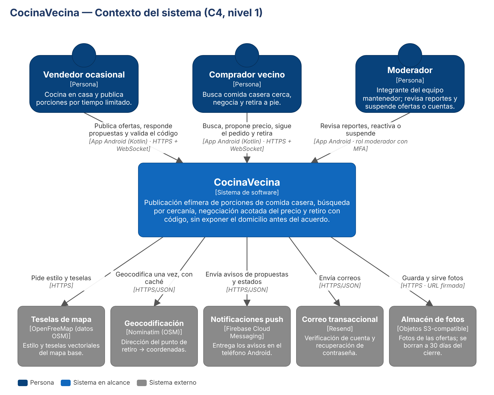

# Arquitectura (resumen)

Modelo elegido: **ALT-1, monolito modular sobre una base relacional espacial**, autoalojado en un servidor
con Docker Compose y sin proxy inverso. Detalle y matriz de decisión en el SRS (§8) y en la presentación de E2.

## Contexto (C4 nivel 1)



## Contenedores (C4 nivel 2)

| Contenedor | Tecnología | Responsabilidad |
|---|---|---|
| App móvil | Kotlin, Jetpack Compose, MapLibre | Mapa y lista, publicación, negociación, código y QR; pantallas de moderación según rol |
| API | Java 21, Spring Boot 4.1 | REST `/v1`, WebSocket `/v1/events`, TLS y HSTS (puerto 443), seguridad JWT + RBAC, reglas de negocio |
| Worker | Misma imagen, perfil `worker` | Expiración de ofertas, solicitudes y ventanas de retiro (cada 60 s); limpieza diaria |
| Base de datos | PostgreSQL + PostGIS | Datos transaccionales, índice GiST sobre `pickup_point.cell_center` |
| Servidor de imágenes | Nginx | Sirve las fotos del volumen compartido por HTTPS en el puerto 8443 (o Cloudflare R2 con `PHOTOS_TYPE=s3`) |

Externos: OpenFreeMap (teselas), Nominatim (geocodificación), Firebase Cloud Messaging (push),
Resend por SMTP (correo), Let's Encrypt (certificado) y, opcionalmente, Cloudflare R2 (fotos).

La app habla directo con la API (`https://<dominio>`) y carga las fotos desde la URL absoluta que entrega la
API (`PHOTOS_PUBLIC_URL`). Ver [ADR 0003](adr/0003-no-reverse-proxy.md).

## Flujo de un pedido

```
Comprador                API                                            Vendedor
   │ POST /offers/{id}/purchase-requests ─▶ PurchaseRequest OFFER_SENT ─(WS/push)─▶
   │                                    ◀─ POST /purchase-requests/{id}/counteroffers (≤ 3 rondas)
   │ POST /purchase-requests/{id}/accept ─▶ UPDATE atómico de stock + Order ACCEPTED
   │ POST /orders/{id}/code ─────────────▶ código (se guarda su HMAC)
   │ GET  /orders/{id}/pickup ───────────▶ dirección y teléfono (RB-5)
   │                                    ◀─ PATCH /orders/{id}/ready ── READY_FOR_PICKUP
   │ muestra código / QR ──────────────────────────────────────────────▶ POST /orders/{id}/delivery
   │                                     DELIVERED; acceso a la dirección se revoca 1 h después
```
